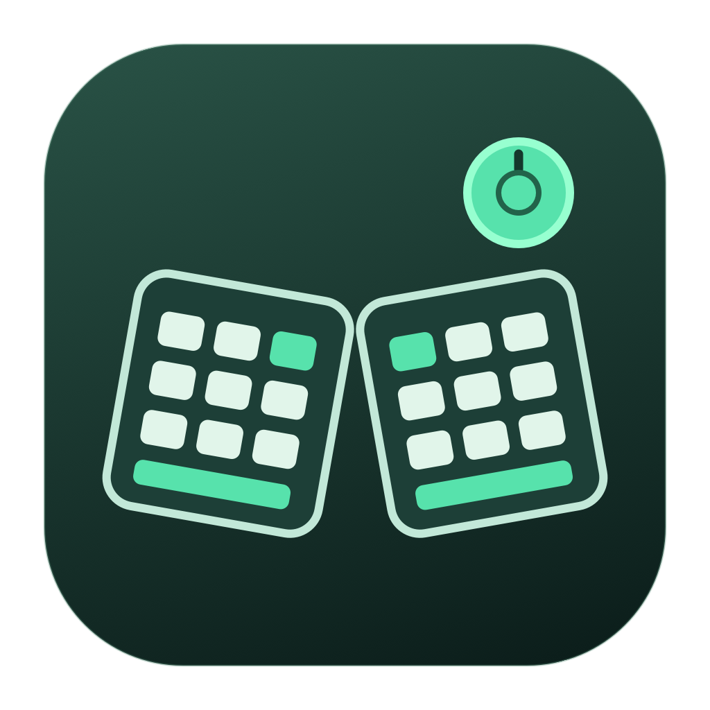

# Ergo Control

A lightweight native macOS menu-bar app for the **Razer Pro Type Ergo (RZ03-0544)** over Bluetooth. Configure buttons, macros, application profiles, and dials without running Synapse.

Ergo Control uses SwiftUI and macOS frameworks, with no third-party runtime packages. It targets only the keyboard’s Bluetooth identity (`068e:02c3`); other keyboards and mice are outside its capture scope. This is an independent project, not affiliated with Razer.

## Features

- Assign M1–M5, AI, dial controls, media controls, and ordinary keys.
- Choose Apple Music or Spotify to open when Play/Pause has no current player to resume, under Keyboard → Buttons. Existing sessions keep their playback controls; macOS default preserves the original behavior. See [music fallback setup and limits](docs/MEDIA_PLAYBACK.md).
- Run shortcuts, text actions, timed macros, selected scripts, and application actions.
- Show or minimize a chosen application with one button.
- Switch profiles automatically for the active application, or select one manually.
- Configure command-dial modes, including keyboard brightness, zoom, scrolling, browser tabs, and the visible native ⌘Tab switcher.
- Set brightness, lighting on/off, battery dimming and wireless sleep under Keyboard → Lighting & power. Optional display-off/idle lighting switches restore your brightness on activity; both default off.
- Use an alternate layer.
- Keep the white Caps Lock indicator synchronized during full control (requires the updated input helper).
- Choose your search and dictation apps under Keyboard → Function keys. Fresh installs use Apple defaults; existing Raycast selection is preserved. Fluid Voice uses a configurable matching hotkey.
- Use Mac F-row defaults: F1/F2 screen brightness, F3 Mission Control, F4 Spotlight or Raycast, F5 Apple dictation or Fluid Voice, F6 emoji, F10 lock, F11 keyboard brightness down, and F12 keyboard brightness up. Explicit shortcut mappings remain available.
- See a brief popup when changing dial modes.
- Press the battery button, or any control assigned **Show battery**, for an on-screen percentage.
- Keep the keyboard icon and battery percentage in a compact menu bar, without a Dock icon. Choose Codex or Claude Code in the Chat apps sidebar section.
- Launch at login and automatically enable saved mappings from the App sidebar section. With automatic mappings enabled, established sessions resume after keyboard disconnection once reconnection and restoration finish; manual Stop cancels recovery.
- Reduce lighting traffic with macro-zone pulse updates, and optionally keep other keys dark during Codex status. See [battery optimization and limits](docs/BATTERY_LIFE.md).
- Use Claude Code as an alternative for recent/starred/fixed chat slots, M1–M5 navigation and the same status-light styles. Local desktop catalog compatibility and live keyboard behavior still need verification; starred chats use newest-first ordering. See [Claude Code setup and limits](docs/CLAUDE_SETUP.md).
- See actual M1–M5 assignments on each chat app's page, including the active profile and Standard/Alternate layer. Available chat slots list their assigned macro keys separately. Browsing app settings preserves key mappings and lighting mode.
- Automatically show status from both apps: approval takes priority; each completion briefly shows its app's wave/color, then the newest ongoing work resumes. Close-together finishes queue so another working app cannot hide them. Choose Automatic, Codex only or Claude Code only independently of the default chat-key app.
- Set separate working, approval and turn-ended colors for each chat app. Codex defaults to blue/red/green and Claude to orange/magenta/cyan; solid lights, waves, pulses and previews use the saved colors.
- Store profiles locally and restore the keyboard’s saved mode when mappings stop.
- Use the dedicated Codex sidebar section to follow the five most recent Codex chats with M1–M5, choose pinned chats or fixed assignments, show lifecycle status, and color the shared macro column. Choose macro-column, whole-keyboard solid, or Status waves: blue once when work starts followed by a steady blue macro column, red bouncing continuously while approval is pending, and green right-and-back once when finished before restoring your previous effect. An optional working pulse fades blue through dim to fully dark and back on the macro keys; it defaults to off. Quick wave speed uses fewer, wider steps; Smooth is the default. A visual light test is included. See [Codex setup and limits](docs/CODEX_SETUP.md).

## Find your way around

- **Keyboard → Buttons:** choose a macro, AI, media or battery card to edit its action. Save mapping applies it; Cancel discards the dialog’s draft. Split keys and other remaps are under Other keys. The test box is expandable below the cards.
- **Keyboard → Dials:** customize either dial and enable/edit the left dial’s modes. Expand one mode to change its clockwise/counterclockwise actions.
- **Keyboard → Lighting & power:** set brightness/on-off, dimming/sleep timers, automatic lighting-off preferences, and backlight effects. Native settings use Apply keyboard settings with readback; the automatic off switches save locally.
- **Keyboard → Function keys:** choose search/dictation providers or expand the F-row to customize a key.
- **Keyboard → Profiles:** rename, duplicate, link apps and choose the default. The sidebar switches the profile you are editing. Save changes keeps profile, dial and function-key edits.
- **Setup & diagnostics:** permissions, input helper and temporary input checks. **App** contains login/startup settings; **App logs** contains recent events.

## Supported hardware and current status

Version **0.9.5** supports **Bluetooth Low Energy** on the Pro Type Ergo. USB and wireless-receiver mappings are not implemented. A separate [read-only USB dial diagnostic](docs/USB_RESEARCH.md) is available for research. The deployment target is macOS 14 or later; hardware validation so far is on Apple Silicon with macOS 27.0.1.

Live tests confirm distinct M1–M5/AI/dial/battery inputs, keyboard brightness across 0–100%, M1 text output, an M2 timed macro, exclusive keyboard capture with left-dial output, normal-mode restoration after timed sessions, the mode popup, menu-bar battery display, and absence from the Dock. **350 automated tests pass.** Desktop Codex events and chat opening are confirmed. Read-only metadata checks match native recent/pinned order. The user confirmed real working/finished colors, improved macro-column visibility, and the initial completion wave. The user reports the continuous approval bounce works. The user reports the steady-blue working phase and F1/F2 screen-brightness defaults appear to work. The user confirmed both search providers and Fluid Voice dictation work. Other F-row defaults, including the corrected 0.6.6 F11/F12 directions, await a hardware check; see [setup](docs/CODEX_SETUP.md). The optional lighting lab produced a user-confirmed moving cyan line over USB and isolated M1–M5 pulsing over both USB and Bluetooth, with effect restoration verified by readback. The user confirmed native Backspace speed, normal D/E typing after navigation, and Magnet’s Control–Option–arrow/Return shortcuts after the build-32 input corrections. Remaining validation includes the physical dial indicator, the new split-key defaults, native application-switcher overlay, app minimize/restore, per-app profiles, alternate layers, non-US layouts, and abnormal recovery. See [setup and verification](docs/APP.md).

The battery popup requests a fresh reading, stays visible for two seconds after the result, and keeps the current app focused. The user confirmed the popup works. Quick reads display the percentage directly; **Checking…** appears only if retrieval takes more than two seconds.

Keyboard backlight brightness is hardware-confirmed and now shows a brief percentage popup. The physical dial’s mode-indicator color is unsupported while mappings are active, so mode changes use an on-screen popup. Dial-color controls and automatic indicator diagnostics are removed from the app; protocol findings remain documented for research. Built-in keyboard backlight effects are available in the Keyboard lighting panel (Off, Static, Breathing, Spectrum cycling, and Wave; effects omitted from the Bluetooth list can be tried explicitly and are checked by readback). Static and Breathing have color choices; Wave has direction controls. General per-zone/custom animation settings are not implemented in the regular app; optional Codex status uses the shared macro zone against dimmed keys or a whole-keyboard signal; the optional Lighting Lab experiments with USB/Bluetooth zone patterns. Firmware updates, onboard macro storage, and Fn-row primary-mode writes are not implemented. Profiles and macros run on the Mac while mappings are enabled. Self-signed DMG packaging and manually triggered test/release workflows are available; pushes, pull requests and tags do not start GitHub builds; no Apple-notarized release is provided. See [release setup](docs/RELEASING.md).

## Build

Install Xcode or its Command Line Tools with **Swift 5.9 or newer**, plus Python 3. The packaging scripts use macOS’s signing, Keychain, and installer tools and an `openssl` executable. Build on macOS:

```sh
git clone https://github.com/serafinski/ergo-control.git
cd ergo-control
swift test
zsh tools/build_app.sh
```

**Ergo Control is the only app needed for everyday use.** “Ergo Control Preview” was a development name for the same app, not a second product. Builds now always produce `build/Ergo Control.app`, with its own app icon and matching menu-bar mark.

Run `zsh tools/build_dmg.sh` to package a disk image. Quit the running app, drag the DMG’s app into Applications, eject the image and open the Applications copy. See [DMG installation, signing secrets and releases](docs/RELEASING.md).

You can also open `build/Ergo Control.app` in Finder. The script creates the app and optional helper installer packages; it does not install or start the helper.

Local builds create a persistent development signing identity in the ignored `build/local-signing/` directory. Keep that directory private and preserve it between builds to retain the same signing identity. Developer ID signing/notarization is a separate distribution step. See [helper and signing details](docs/INPUT_HELPER.md).

## Setup and use

1. Keep PT Ergo connected over Bluetooth. Quit the diagnostic apps and the Synapse/App Engine GUI before enabling mappings.
2. Grant **Ergo Control** Input Monitoring and Accessibility in System Settings → Privacy & Security. Accept its Bluetooth prompt.
3. Open **Setup & diagnostics**. For full dial/keyboard replacement, click **Install input helper…**, complete the macOS administrator installer, then grant the installed helper its own Input Monitoring entry. Its path is `/Library/PrivilegedHelperTools/dev.local.ergocontrol.inputhelper`.
4. Open Keyboard → Buttons → M1, choose **Type text**, enter a phrase and click **Save mapping**. Enable mappings, expand **Try your mappings**, click its text box and press M1. An optional 60-second test is under Setup & diagnostics → Advanced input checks.
5. Use **Enable mappings** for normal operation. Close Settings to leave the app in the menu bar; reopen it through **Settings…** there. **Stop mappings** releases input and requests a verified restoration. **Quit Ergo Control** exits after restoration when required.

The optional input helper is this project’s small, narrowly scoped launch daemon; it is not a Razer driver or a kernel/system extension. A limited non-seizing extra-button mode is available without full capture, but cannot replace ordinary keys or dial/media actions. See [setup and limitations](docs/APP.md) and [the helper’s trust boundary](docs/INPUT_HELPER.md).

Settings live under `~/Library/Application Support/ErgoControl/Settings/`. The mapping app does not save ordinary typed text; the optional probe records raw input only during explicitly started tests. Captures, Bluetooth diagnostics, vendor research artifacts, installers, and signing material are excluded from Git.

## Documentation and development

- [DMG installation, GitHub releases and automatic startup](docs/RELEASING.md)
- [App setup, mappings, and validation](docs/APP.md)
- [Helper architecture, signing, and installation](docs/INPUT_HELPER.md)
- [Recovered Bluetooth and input protocol](docs/PROTOCOL.md)
- [Macro-key lighting capabilities and Chroma research](docs/MACRO_LIGHTING.md)
- [Optional lighting pattern tests and recovery](docs/LIGHTING_LAB.md)
- [Chroma value and adapting Codex Micro to five macro keys](docs/CODEX_AND_CHROMA.md)
- [Optional diagnostic apps and tools](docs/DIAGNOSTICS.md)
- [Research and hardware-test history](docs/research/INVESTIGATION.md)
- [Contributing](CONTRIBUTING.md)

The research archive preserves provenance and the distinction between static findings and observed hardware behavior. It contains documentation and hashes, not vendor binaries or extracted vendor source. A fresh clone can build and test the app without those artifacts or an installed Razer application.

## License

[MIT](LICENSE), copyright © 2026 serafinski. Razer product names and trademarks belong to their respective owners. The license applies to this project’s source and documentation, not to separately obtained vendor artifacts.

Razer's lighting map groups M1–M5 into one shared zone; separate macro-key colors are not exposed. Custom USB/Bluetooth zone control is available through the optional lighting lab, with isolated macro-column pulsing confirmed on both connections; it is not part of normal mapping sessions. See [the findings](docs/MACRO_LIGHTING.md) and [roadmap](docs/ROADMAP.md) for possible whole-column status lighting.
